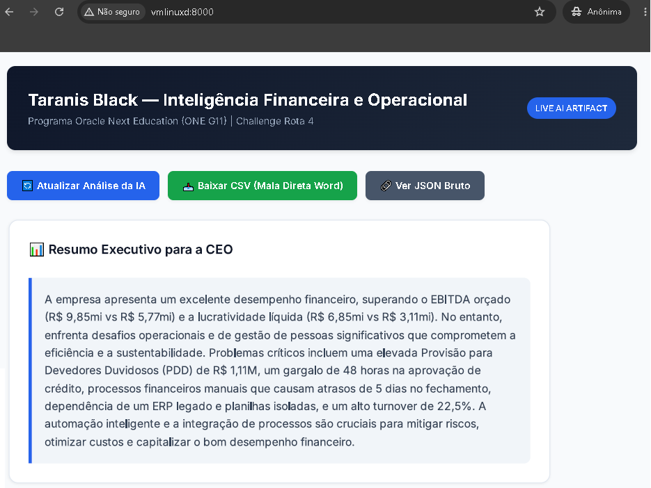

<!--
Label: 🚀 [Taranis Finance AI]: Automação Financeira e Inteligência Artificial com Spring Boot e Gemini API
Description: [👻 Descrição do projeto]: Um projeto prático de arquitetura full-stack integrando Spring Boot 3.3.4, WebClient reativo e a API do Gemini para gerar relatórios e diagnósticos financeiros automatizados para o ecossistema Taranis Black (Rota 4).
technical_requirement: Lógica de Programação, Estrutura de Dados, Integração de APIs REST, Programação Reativa, Resolução de Problemas.
skills: Aprendizado Contínuo, Design de Sistemas Escaláveis, Metodologias Ágeis (Scrum/Kanban), Pensamento Crítico e Análise, Comunicação Interpessoal, Autogestão de Tempo.
professions: Desenvolvedor(a) Full Stack, Engenheiro(a) de Software, Cientista de Dados, Arquiteto(a) de Software.
Tags: Fund -> hookfigma.hook9, Dev -> hookfigma.hook7, Skils -> hookfigma.hook13
path_hook: hookfigma.hook9, hookfigma.hook7, hookfigma.hook13
-->


# ⚡ Taranis Finance AI — Inteligência Operacional e Financeira

[](https://openjdk.org/)
[](https://spring.io/)
[](https://maven.apache.org/)



---

## 📌 Visão Geral do Projeto

Este projeto consolida a entrega técnica do **Challenge Rota 4 (Finanças e Operações)** da empresa simulada **Taranis Black** pelo programa **Oracle Next Education (ONE G11) & Alura**. A solução une automação de infraestrutura via Bash (`gerar_projeto.sh` e `up.sh`) a uma aplicação corporativa robusta em **Java Spring Boot**, integrando o **WebClient reativo** com a **Gemini API** (`gemini-2.5-flash`) para gerar diagnósticos financeiros em tempo real e exportação automatizada para mala direta corporativa.

---

## 🏗️ Arquitetura e Componentes do Sistema

| Camada / Arquivo | Responsabilidade Principal |
| :--- | :--- |
| 🛠️ **Script Bash (`gerador.sh`)** | Automatiza a criação da árvore de diretórios, arquivos de configuração (`pom.xml`, `.env`, `application.properties`) e classes Java. |
| 🌐 **Frontend (`index.html`)** | Dashboard executivo dinâmico construído com **HTML5, CSS3 moderno (Inter Font)** e JavaScript assíncrono (`fetch API`) para exibição em tempo real. |
| 🚀 **Controllers (`HomeController`, `TaranisController`)** | Gerenciam rotas web, endpoints REST de análise e exportação automatizada para formato CSV. |
| 🤖 **Serviços (`GeminiApiClient`, `TaranisFinanceService`)** | Consomem a API do Google de forma reativa (`WebClient` / `Mono`) e aplicam engenharia de prompt especializada. |
| 📦 **Modelos (`FinanceReportDTO`)** | Mapeamento dinâmico baseado em chave-valor (`@JsonAnyGetter` / `@JsonAnySetter`) para lidar com estruturas JSON flexíveis da IA. |

---

## 📊 Os Principais Insights Chaves

| Pergunta / Diretriz | Resposta / Cenário Mapeado | Insights Acionáveis |
| :--- | :--- | :--- |
| **Qual é o principal gargalo operacional?** | Atraso de 48h em análise de crédito e conciliação manual entre 3 planilhas isoladas e um **ERP legado**. | Eliminar o retrabalho manual integrando APIs diretas de validação cadastral. |
| **Qual é o impacto financeiro mapeado?** | EBITDA realizado de R$ 9,85mi vs R$ 5,77mi orçado, com provisão de devedores duvidosos (**PDD**) de R$ 1,11M. | Monitorar rigorosamente o fluxo de caixa e os custos logísticos (fretes de R$ 960k). |
| **Como a IA atua na solução?** | Automatiza a leitura dos relatórios e estruturação de dados em formato JSON consumido pelo dashboard. | Reduzir o tempo de fechamento gerencial de 5 dias para menos de 1 hora. |

---

## 📚 Jargões e Termos Relevantes

* **WebClient:** Cliente HTTP reativo introduzido no Spring WebFlux para chamadas assíncronas e não-bloqueantes.
* **DTO (Data Transfer Object):** Padrão de projeto utilizado para transferir dados entre diferentes camadas de um sistema.
* **PDD (Provisão para Devedores Duvidosos):** Estimativa contábil de perdas com clientes inadimplentes.
* **Turnover:** Indicador de rotatividade de colaboradores (taxa de desligamentos e contratações na empresa).
* **ERP Legado:** Sistema de gestão empresarial antigo, geralmente rígido e de difícil integração com novas tecnologias.

---

## 🚀 Como Executar o Projeto Localmente

Para subir todo o ecossistema de forma automatizada e segura no seu ambiente Linux/Docker, siga os passos abaixo:

```bash
# Execute o script de inicialização inteligente (com verificação e mascaramento seguro da chave)
bash up.sh
```
---

## 💡 Frase de Engajamento

> *"Agradecemos imensamente a todos os mentores e colegas da comunidade ONE G11 e Alura.
> 

